

  

# NotePrime — Material You Fork

> A modern, Android-specific fork of [Note Safe by jeerovan](https://github.com/jeerovan/ntsapp) (now NotePrime) with Material You theming, a refined UI, and ongoing improvements. Support for other platforms will be considered in the future.

Notes app with a chat-like interface and end-to-end encrypted cloud backup/sync.

---

## Install

> [!WARNING]  
> **Important Migration Notice:** If you are installing this fork seamlessly over the original Note Safe application, **you must safely back up your data first!** Because cryptographic security signatures and local database architectures may incrementally differ, please ensure you export all your notes as a secure `.zip` backup from within the original app *before* overwriting it with this version. You can then instantly restore your data inside the fork!

*   **Android (Fully Supported)** — [GitHub Releases](https://github.com/FarhanZafarr-9/ntsapp/releases/)
*   **Android via Obtainium** — Import this repo straight from source and get automatic updates on release.
*   **Other Platforms (Planned)** — Support for Windows, Linux, macOS, and iOS will be evaluated in the future.

[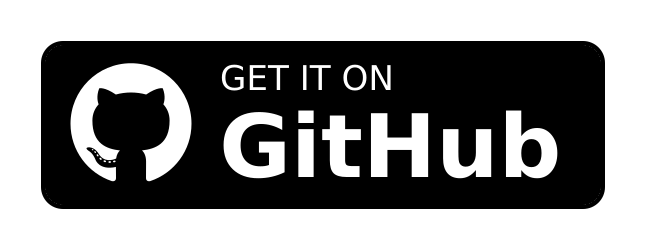](https://github.com/FarhanZafarr-9/ntsapp/releases/)
[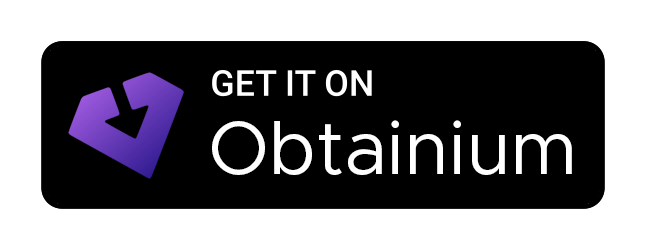](https://apps.obtainium.imranr.dev/#github.com/FarhanZafarr-9/ntsapp)

---

## Screenshots

  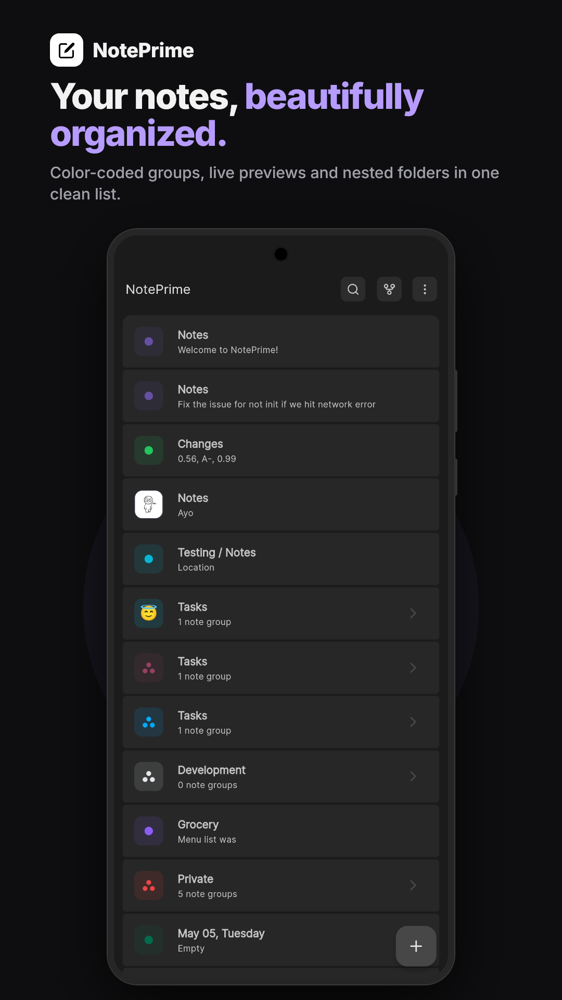
  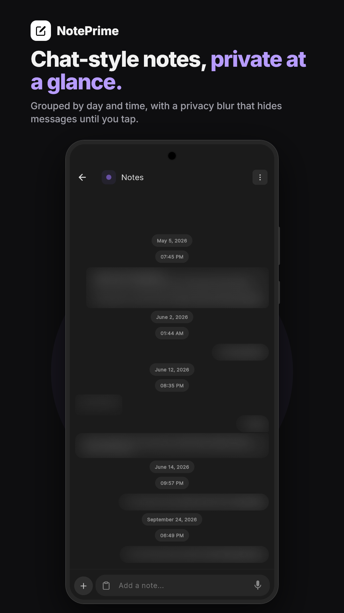
  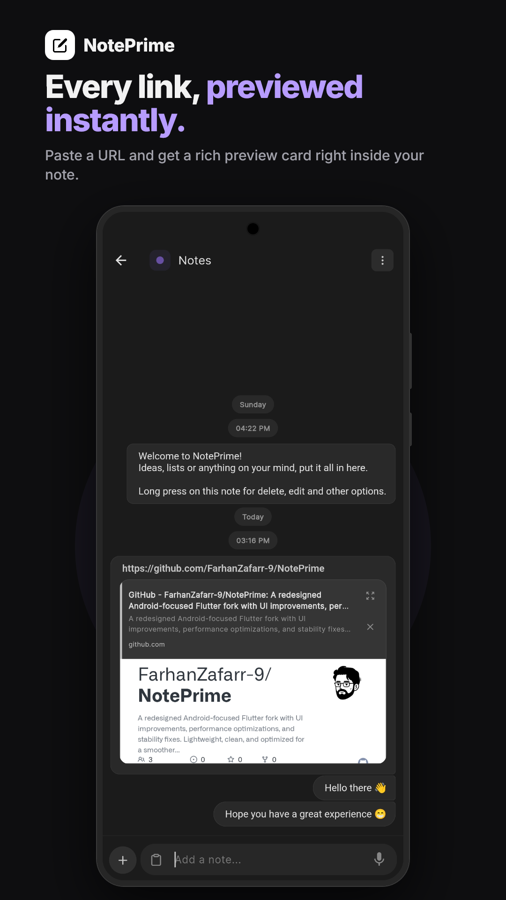
  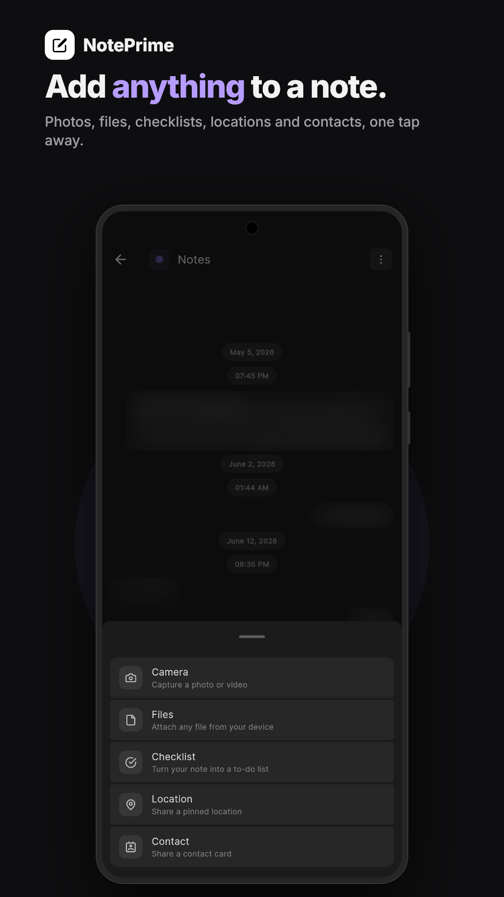
  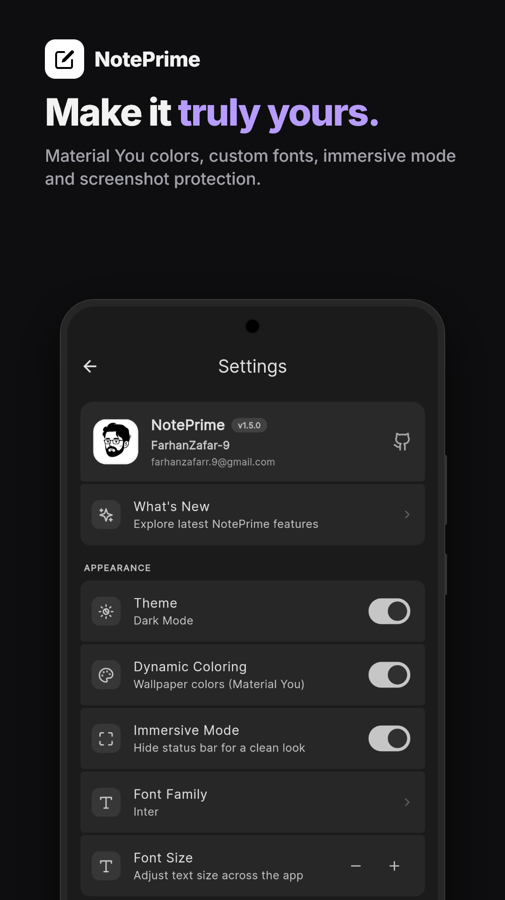

### Notes

<table>
<tr>
<td width="170"></td>
<td><b>Home</b> Color-coded groups with previews and nested folders in a clean list.</td>
</tr>
<tr>
<td width="170"></td>
<td><b>Chat-style feed &amp; Privacy Shield</b> Asymmetric bubbles grouped by day and time, with an optional per-group blur that hides messages until you tap.</td>
</tr>
<tr>
<td width="170"></td>
<td><b>Link previews</b> Paste a link and get a rich preview inside the note.</td>
</tr>
<tr>
<td width="170"></td>
<td><b>Attachments</b> Camera, files, checklists, locations and contacts from one sheet.</td>
</tr>
</table>

<b>Groups &amp; organization</b>

 
<table>
<tr>
<td width="170">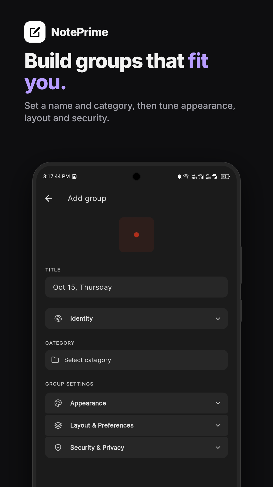</td>
<td><b>Add group</b> Title, category, then appearance, layout and security settings.</td>
</tr>
<tr>
<td width="170">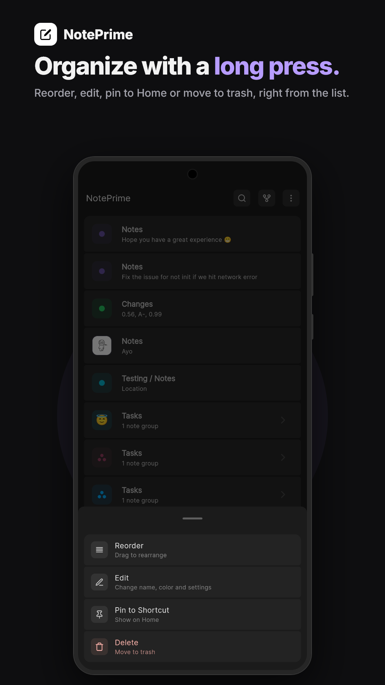</td>
<td><b>Group menu</b> Reorder, edit, pin to a Home shortcut, or move to trash.</td>
</tr>
<tr>
<td width="170">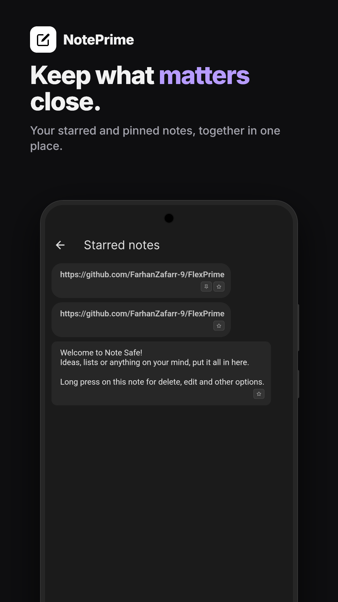</td>
<td><b>Starred notes</b> Starred and pinned notes in one list.</td>
</tr>
</table>

<b>Customization &amp; privacy</b>

 
<table>
<tr>
<td width="170"></td>
<td><b>Settings</b> Material You dynamic colors, fonts, immersive mode, per-group settings, screenshot protection and biometric grace period.</td>
</tr>
<tr>
<td width="170">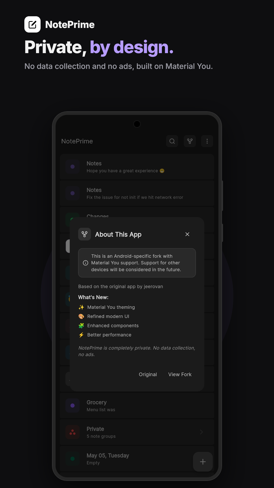</td>
<td><b>About</b> What's new in the fork. No data collection, no ads.</td>
</tr>
</table>

---

## What's Different in This Fork

This fork builds on the solid foundation of the original Note Safe app and completely modernizes the experience:

### Overview of Enhancements
*   **Material 3 & Material You** — Implements dynamic color engines that seamlessly adapt to your system palette (Android 12+), fully transforming all UI components, dialogs, and panels.
*   **Refined Chat UI** — Overhauled the conversation view featuring asymmetric message bubbles, dynamic width constraints, dedicated swipe-to-reveal exact timestamps, and day-based visual grouping (`Today`, `Yesterday`).
*   **Intelligent Media Viewer** — Re-engineered standard viewers to automatically scale exceptionally wide panoramas and tall screenshots, enabling natural scrolling and edge-to-edge boundary tracking with 10.0x pinch-to-zoom limits and native *Save to Downloads* functionality.
*   **Advanced Formatting** — Restyled embedded location, contact, audio, and file widgets with sleek tonal backgrounds, circular borders, and contextual padding algorithms.
*   **Glance-Privacy Shield** — Introduced a granular per-group "Privacy Shield" that blurs sensitive text and media thumbnails with a premium glassmorphic effect. Content remains hidden until revealed with a tap, strictly gating all message interactions while active.
*   **Advanced Security Layers** — Integrated a highly robust "App-Lock Shield" featuring **Screenshot Protection** (blocking captures on Android) and **Biometric Grace Period** settings for adjustable lock delays.
*   **Dynamic UI Controls** — Added **Immersive Mode** for distraction-free full-screen usage and **Custom Typography** support via Google Fonts integration (Inter, Lora, Roboto Mono).
*   **Media & Storage Management** — Implemented granular **Auto-Download** controls (Wi-Fi vs Cellular) and a **Smart Cache Utility** with real-time size display and one-tap clearing.
*   **Sleek Menus & Settings** — Standardized floating popup menus and completely refactored the settings layouts into deeply integrated Material 3 list tiles featuring inline high-precision color-picker dialogs.

### Differences at a Glance

| Feature / Interface | Original Implementation | NotePrime (v1.0.0) |
| :--- | :--- | :--- |
| **Theming Engine** | Static custom themes and blocky elements | Full Material 3 support with system-level **Material You** integration |
| **Message Layouts** | Symmetrical blocks across the screen | Modern **asymmetric chat bubbles** adapting dynamically to content width |
| **Feed Experience** | Timestamps attached to every internal item | Grouped chronological headers with **swipe-to-reveal** item timestamps |
| **Media Previews** | Distorted borders or unscalable limits on long images | **Edge-to-edge** rendering, panorama detection, and smooth native panning |
| **Security Gates** | Basic lock overlays | **App-Lock Shield** with **Screenshot Blocking** and adjustable **Grace Periods** |
| **Customization** | Standard system fonts only | **Google Fonts** integration and specialized **Immersive View** |
| **Storage Control** | Black-box cache management | **Smart Cache Utility** with size visualization and control |

---

## About NotePrime

NotePrime is a private, open-source notes app where every note lives in a chat-style feed. It is **local-first**: notes are written to the device, the app is fully usable offline, and only encrypted data ever leaves it. Photos, audio, video, files, checklists, locations and contacts can all sit inside a note, and the entire workspace can be exported and restored as a `.zip` backup whenever you want.

### Privacy by design

Notes are encrypted on-device with **Libsodium** — XSalsa20-Poly1305 secret boxes, with keys derived from your password via **Argon2id** and stored in the platform's secure storage. Supabase is only ever handed ciphertext it has no way to read, so neither the backend nor anyone else with access to it can decrypt your notes.

On top of that encryption:

*   **Privacy Shield** — blur an entire group until you tap it, so a screen you hand to someone else stays unreadable.
*   **Screenshot blocking** — prevents captures of the app window on Android.
*   **Biometric grace period** — choose how long the app stays unlocked before it asks you again.
*   **No ads, no selling your data** — free of advertising and third-party content tracking.

### Built for Android first

The interface is Material 3 with **Material You** dynamic colour, so on Android 12+ the app picks up your system palette across every screen, dialog and sheet. It also ships Google Fonts support, an immersive distraction-free mode, granular auto-download rules for Wi-Fi versus cellular, and a cache utility with live size reporting. Other platforms are planned, but Android is what ships today.

Built with Flutter, Supabase for encrypted sync, and Material 3 throughout.

---

## Security

If you believe you have found a security vulnerability, please email [getphonesafe@gmail.com](mailto:getphonesafe@gmail.com) instead of opening a new issue.

---

## Credits

Original app made with ❤️ by [jeerovan](https://github.com/jeerovan/ntsapp) and team [Olauncher](https://github.com/tanujnotes/Olauncher).

Fork maintained by [FarhanZafarr-9](https://github.com/FarhanZafarr-9).